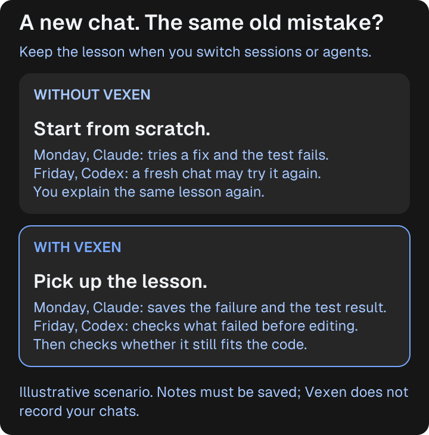
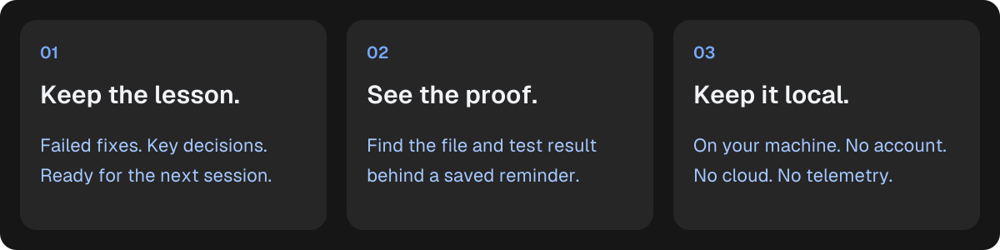
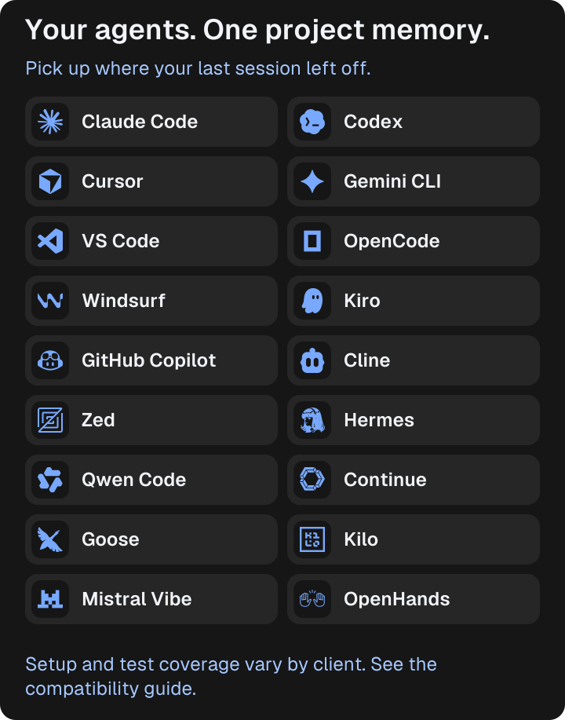
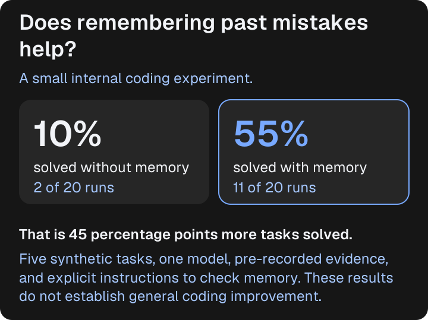
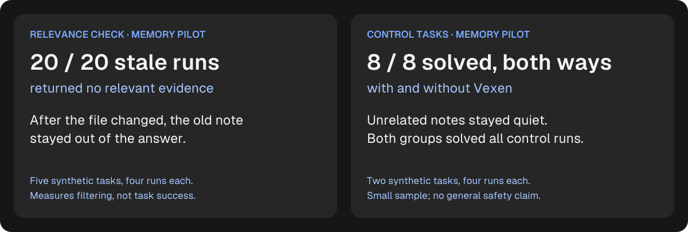
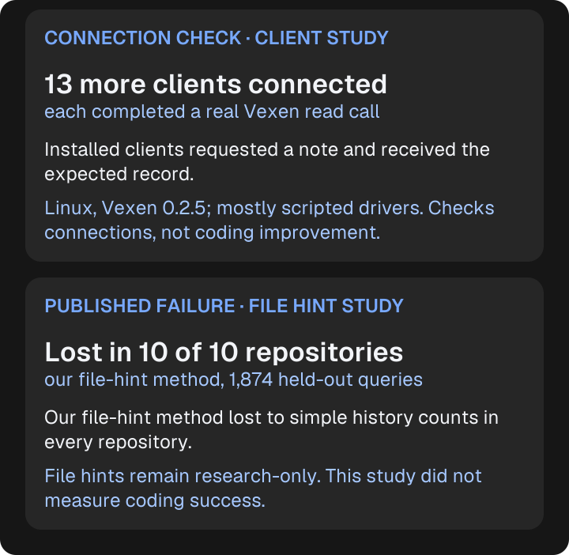

<p align="center">
  <picture>
    <source media="(prefers-color-scheme: dark)" srcset="icon.svg">
    
  </picture>
</p>

<h1 align="center">Vexen</h1>

<p align="center"><strong>Your AI agent forgot what failed. Vexen didn't.</strong></p>
<p align="center">Stop losing lessons between coding sessions.<br/>Save failed fixes and important decisions so your next agent can check them before trying again.</p>

<p align="center">
  
  
  
  
</p>

<p align="center"><a href="#get-started"><strong>Get started →</strong></a> · <a href="#does-it-help">See the evidence</a> · <a href="docs/getting-started.md">Setup help</a></p>

Vexen is a shared memory for AI coding tools such as **Claude Code, Codex and Cursor**. It keeps notes with your project, so switching tools or opening a new chat doesn't have to mean explaining the same failed fix again.

## Here's what changes

<p align="center"></p>

**You don't need to save an entire conversation.** Your agent saves a short note about what failed, along with its test result, or a decision you've accepted. A later session can check those notes before editing the same code.

*Illustrative scenario. Notes need to be recorded; Vexen does not automatically remember your chats.*

<p align="center"></p>

## Get started

Open a terminal **inside the Git project you want Vexen to remember**. You'll need [Node.js 18 or newer](https://nodejs.org/) and Git.

**1. Create your project's memory and connect your coding tools.**

macOS / Linux:

```sh
npx @onurbyte/vexen init
npx @onurbyte/vexen install --scope global --npx
```

Windows PowerShell:

```powershell
npx.cmd @onurbyte/vexen init
npx.cmd @onurbyte/vexen install --scope global --npx
```

The first command creates a local `.vexen/` folder. The second adds Vexen to supported coding tools it detects. Read the output: some tools need a manual step. **Restart your coding tool** after setup.

**2. Try it in your agent's chat.**

```text
Use Vexen to check this project's README.md for past failures or decisions.
```

On a new project, **“no relevant evidence” is the expected answer**. Your memory starts empty and grows as lessons are saved. If your agent can't find Vexen, follow the [connection guide](docs/getting-started.md#2-connect-your-agents).

**3. Save a useful lesson when one happens.**

After a test fails during your work, ask your agent:

```text
Save this failed attempt in Vexen with the affected file and the actual
failing test result, so a future session can check what happened.
```

Vexen only brings back failed attempts with a recorded failing test result, or decisions you've accepted. A note by itself is not a verified failure. If the file changes, an old note stops appearing.

**Want reminders to check and save lessons?** Add the optional [agent skill](skills/vexen/SKILL.md). It works with the `vexen` command on your PATH or, if you only use `npx`, through `npx @onurbyte/vexen`; the setup above already connects the agent through MCP, the tool connection it uses to read and save notes. See [the setup guide](docs/getting-started.md#3-use-it).

[Full setup guide →](docs/getting-started.md) · [Download without Node.js →](https://github.com/OnurByte/Vexen/releases/latest)

## Works across coding tools

Start a task in Claude Code. Continue in Codex or Cursor. **Saved lessons stay with the project.** Each tool needs to be connected to Vexen, and your agent needs to check for relevant notes.

<p align="center"></p>

The installer supports eight tools. Additional clients have been tested with real Vexen tool calls; setup and coverage vary. [Find your tool and see what was tested →](docs/client-smoke-tests.md)

## Does it help?

<p align="center"></p>

In our controlled pilot, Claude Code using Haiku solved **11 of 20 targeted task runs with relevant Vexen memory**, compared with **2 of 20 without memory**.

This was a small internal study using five synthetic tasks, pre-recorded evidence and explicit instructions to check memory. It does **not** establish general coding improvement.

[See the method, the full 76-run pilot (this comparison uses 40 of its runs) and limitations →](docs/pilot-results.md) · [Inspect the raw data →](benchmarks/memory/results/pilot-2.jsonl)

**Useful memory also needs to know when to stay quiet.** We checked what happened when a saved note was out of date or about a different file.

<p align="center"></p>

The stale-note check measured whether an old record was withheld; those runs solved 0 of 20 tasks. The control result means no drop was observed on those two tasks. Neither is a guarantee for other projects. [Read the relevance checks →](docs/research.md#relevance-checks)

**Tested connections. Published misses.** We also test whether coding tools can actually retrieve a saved note, and publish experiments that did not earn a place in the default product.

<p align="center"></p>

[See the 13 client checks →](docs/client-smoke-tests.md) · [Read the unsuccessful file-hint experiment →](docs/benchmarks.md)

<details>
<summary><strong>What did the coding tasks actually test?</strong></summary>

These were small Python tasks with requirements hidden from the visible tests. The saved notes described earlier failures involving those requirements. Each row below includes all four repetitions per condition, rather than a selected successful run.

| Task | What the saved lesson explained | Without memory | Vexen enabled |
|---|---|---:|---:|
| Read an exported file | A special UTF-8 file marker needs to be handled | 1 / 4 | 3 / 4 |
| Calculate a price | `0.125` must round to `0.13` | 1 / 4 | 2 / 4 |
| Build a URL slug | `München` must become `muenchen` | 0 / 4 | 2 / 4 |
| Parse an export date | `04/03/2025` means 4 March | 0 / 4 | 2 / 4 |
| Read exported rows | Accept semicolons as well as commas | 0 / 4 | 2 / 4 |

These examples show the kind of project-specific lesson Vexen can carry. They are synthetic test cases, not customer stories. The notes were prepared in advance and the agent was told to check memory. In the Vexen-enabled group, all 20 runs called the tool; the last logged response contained a failure record in 12 and no relevant evidence in eight. Even with Vexen enabled, nine runs failed.

[Task definitions](benchmarks/memory/tasks.py) · [Additional tasks](benchmarks/memory/tasks_extra.py) · [Full results](docs/pilot-results.md)

</details>

[Explore the research, evidence and limits →](docs/research.md)

## Your project. Your memory.

- **Local storage.** Notes live in your project's `.vexen/` folder. Database files are ignored by Git.
- **No Vexen cloud or telemetry.** Vexen doesn't record your chats. Your coding tool's own data policies still apply.
- **A source for each reminder.** Check the file, commit and recorded result behind a note.
- **Nothing relevant? It says so.** Old or unrelated evidence should not become advice for new code.

Vexen is in early development. It gives your agent context to consider; the agent still needs to inspect the current code and test its work.

[Privacy](docs/security.md) · [Documentation](docs/README.md) · [Compatibility](docs/client-smoke-tests.md) · [Roadmap](docs/roadmap.md) · [Report an issue](https://github.com/OnurByte/Vexen/issues)

GPL-3.0-or-later · [License](LICENSE). Independent; not affiliated with Vercel. [Geist fonts](https://github.com/vercel/geist-font) are used under the SIL Open Font License.
