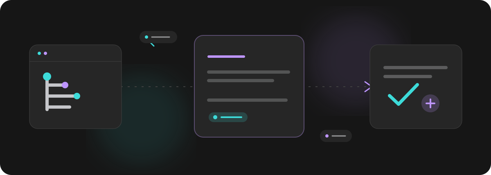
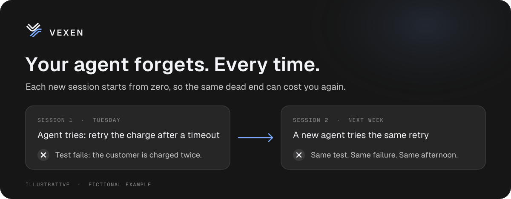
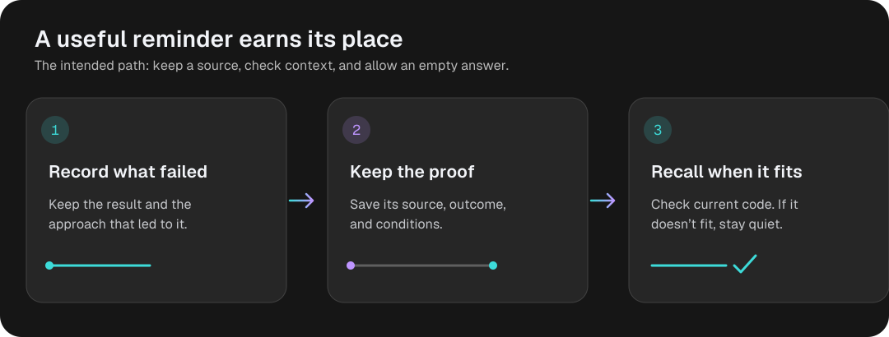
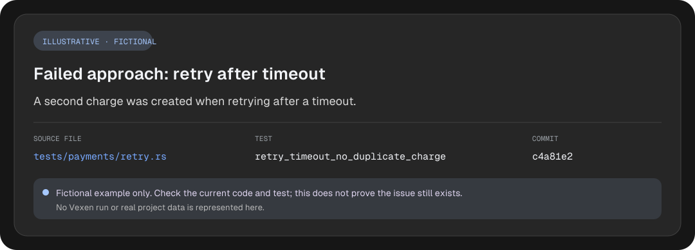
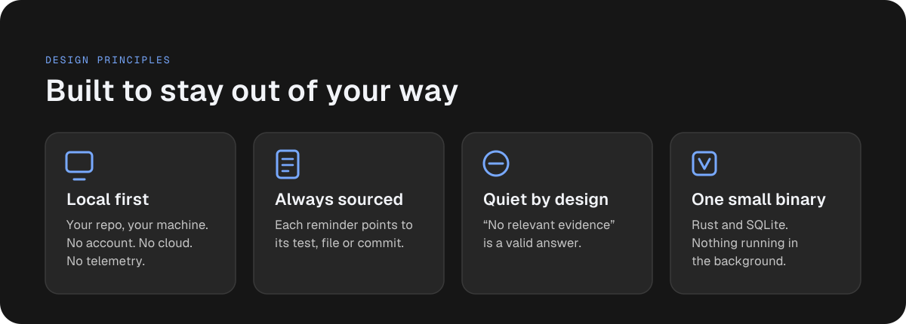
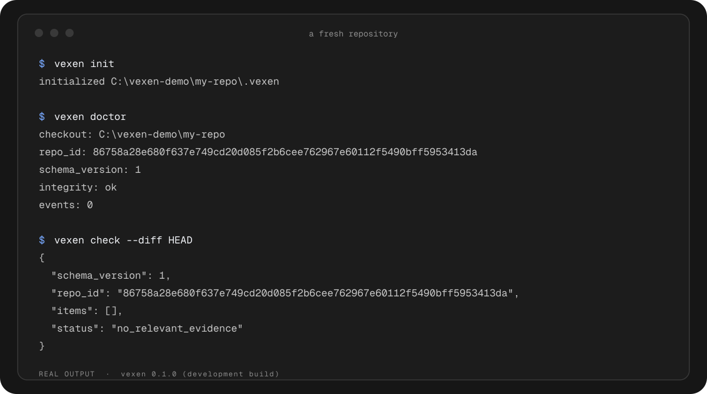
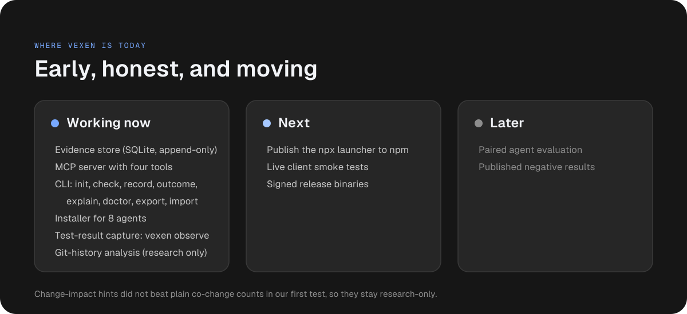

<p align="center">
  <picture>
    <source media="(prefers-color-scheme: dark)" srcset="icon.svg">
    
  </picture>
</p>

<h1 align="center">Vexen</h1>

<p align="center"><strong>Give your next coding agent a head start.</strong><br/>Coding agents forget what failed. Vexen keeps a local, source-linked record of it in your repository, and says nothing when it no longer applies.</p>

<p align="center">
  
  
  
  
  
</p>

<p align="center"></p>

Coding agents are fast, but every session starts cold. Vexen keeps a small, local record of what past attempts in your repository actually showed, with the source for each, so the next agent can check it before repeating a dead end.

> **Early development.** The pieces below are real and tested, but Vexen is not a finished product yet. [Where it stands](#where-vexen-stands) lists what works today and what does not.

## The problem

<p align="center"></p>

Your history shows what shipped. It rarely shows what was tried and abandoned, or why. Generic "memory" can make it worse by surfacing stale or unrelated advice. Vexen is built around the opposite rule: say something only when the evidence still fits.

## How it works

<p align="center"></p>

1. **Record what failed.** An agent saves the attempt and its result through the MCP server.
2. **Keep the proof.** The note stays tied to a file, a commit and the test that showed it.
3. **Recall it only when it fits.** Before an edit, Vexen checks whether the evidence still applies to the current code. If not, it says there is no relevant evidence.

### What a reminder looks like

<p align="center"></p>

This example is fictional and shows the planned format. On a fresh repository the real answer is "no relevant evidence" (see the terminal output below).

## Built to stay out of your way

<p align="center"></p>

A test result is evidence about one code state, not a guarantee. Vexen reports what happened and where it came from, and leaves the decision to you and your agent. It does not block edits, gate approvals, or record your chat transcripts.

## Try it today

Vexen builds from source (Rust 2024 and Git required):

```sh
cargo install --git https://github.com/OnurByte/Vexen --locked
cd my-repo
vexen init
vexen doctor
vexen check --diff HEAD
```

<p align="center"></p>

On a fresh repository the honest answer is "no relevant evidence", and that is what you see.

**Connect your clients with one command.** `vexen install` adds the MCP entry to the config files of the agents it finds (Claude Code, Codex CLI, Cursor, Gemini CLI, Windsurf, Kiro, VS Code, OpenCode). Preview first, then apply; `vexen uninstall` removes only what it added:

```sh
vexen install --scope global --dry-run
vexen install --scope global
```

It writes only the `vexen` entry, keeps a one-time `.vexen-backup` of any file it edits, and refuses (printing the snippet) when a file cannot be edited safely, for example JSON with comments. Zed and Cline print a snippet only. Scopes differ: VS Code is project-only, Codex CLI and Windsurf are global-only, and `--agent auto` only picks clients whose config folder it finds. The file formats of the automated clients are covered by tests. Claude Code (2.1.309), OpenCode (2.2.5) and Codex CLI (0.166.0) have each been checked live once, on Windows: a real model called `vexen_check` through the server entry and got a recorded failure back. For Claude Code and OpenCode the entry came from the file `vexen install` wrote; for Codex the same `mcp_servers.vexen` keys were passed with `-c`. The other clients are config-tested only.

**Use it from an agent.** `vexen mcp --stdio` serves four MCP tools: `vexen_check` reads past evidence for a file, `vexen_record` saves a failed attempt or a decision, `vexen_outcome` attaches a test result, and `vexen_explain` shows where a note came from. Point any MCP client at it, for example:

```json
{ "command": "vexen", "args": ["mcp", "--stdio"] }
```

Agents pass the repository root explicitly on every call, so one server never leaks memory between projects. Your data lives in `.vexen/` inside the repository, and the database files are ignored by Git. `vexen export` and `vexen import` move it as versioned JSONL.

**Use it as an agent skill.** [`skills/vexen/SKILL.md`](skills/vexen/SKILL.md) teaches an agent when to run `vexen check` before an edit and `vexen record` after a failed attempt. It follows the Agent Skills format, so any compatible agent can install it from this repository (the skill does not install the `vexen` binary itself):

```sh
npx skills add OnurByte/Vexen
```

Without MCP, agents save notes with `vexen record --path <file> --summary "<what happened>"` and attach a test result with `vexen outcome <id> --test-id <test> --exit-code <n>`, or run the test and attach it in one step with `vexen observe <id> --test-id <test> -- <command>` (`<id>` is the id `vexen record` printed) (only the exit code and an output hash are stored).

**No Rust?** Prebuilt binaries with SHA-256 checksums for Windows, Linux (x64, arm64) and macOS (x64, arm64) are on the [Releases page](https://github.com/OnurByte/Vexen/releases). They are early builds and have not been tested with live agent clients.

**`npx`, without installing Rust.** `npx @onurbyte/vexen init` works without Rust: a small launcher in [`npm/`](npm/) downloads the checksummed binary for your platform on first run, verifies it, and runs it. For an MCP client use `{ "command": "npx", "args": ["-y", "@onurbyte/vexen", "mcp", "--stdio"] }`. See [`npm/README.md`](npm/README.md).

## Where Vexen stands

<p align="center"></p>

We publish results that do not flatter us. Our first experiment tried to predict which files change together. It did not beat plain historical co-change counts on any of ten repositories, so those hints stay research-only and are never shown by default. The numbers measure file retrieval, not whether agents finish tasks better. See the [evaluation and its limitations](docs/benchmarks.md).

Only Claude Code, OpenCode and Codex CLI have been smoke-tested live, once each, on Windows. A paired pilot (100 real agent runs on toy tasks, two rounds) is written up in [docs/pilot-results.md](docs/pilot-results.md): with an applicable note the agent passed 11 of 20 tasks that hide a requirement, against 2 of 20 without memory and 0 of 20 when the note was stale; Vexen with nothing to say did no harm on the controls. The tasks are toy-sized and written by us, so no effect in real repositories is claimed.

## Privacy

Details are in [docs/security.md](docs/security.md); formats and the MCP tools are in [docs/formats.md](docs/formats.md) and [docs/protocol.md](docs/protocol.md).

Vexen reads local Git history and stores what you or your agent record. By design it makes no network calls, has no telemetry, and does not capture prompts, transcripts, command output or credentials. Secret-like text is refused at record time. Imported text is treated as data, never as instructions.

## Build and contribute

```sh
cargo test                                  # unit and integration tests
cargo bench --bench cochange -- /path/to/repo.git 0.8 --per-query out.jsonl
```

The benchmark reads a **local** repository; reproduction details are in [docs/benchmarks.md](docs/benchmarks.md). The plan and task list live in [docs/specification.md](docs/specification.md), progress in [docs/progress.md](docs/progress.md), and the look and voice in [brand.md](brand.md).

Two fixtures need file names some systems refuse (control characters on Windows, non-UTF-8 bytes on macOS); CI skips them there.

## License

GPL-3.0-or-later. See [LICENSE](LICENSE). Vexen is independent and is not endorsed by Vercel; the [Geist](https://github.com/vercel/geist-font) fonts in diagrams are under the SIL Open Font License.
