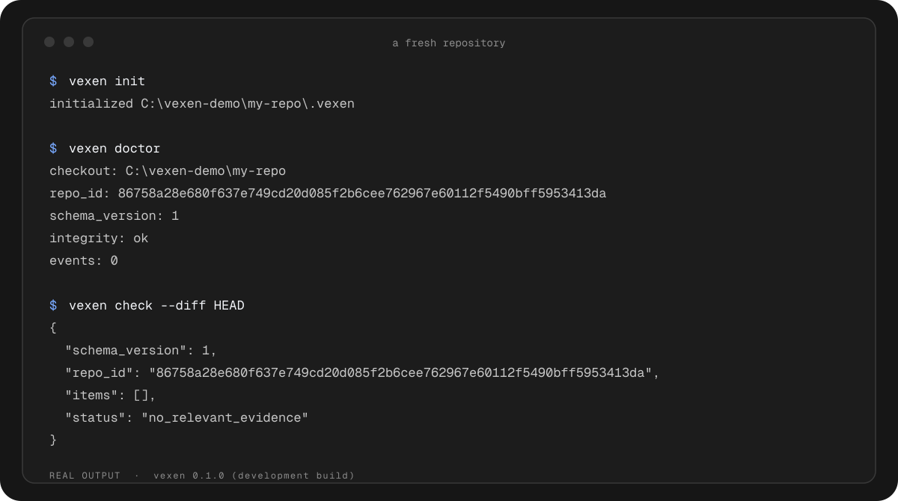

# Installation and usage

### Download the binary

1. [Download Vexen](https://github.com/OnurByte/Vexen/releases/latest) for your operating system. Choose Apple Silicon or Intel on macOS; most Windows and Linux computers use x64.
2. Extract the ZIP or tar.gz archive. On macOS and Linux, make the binary executable if needed: `chmod +x vexen`.
3. Put the binary in a folder on your PATH. On macOS and Linux, a common choice is `~/.local/bin` (the folder must already be on your PATH). On Windows, put `vexen.exe` in a permanent folder and add that folder to your user Path in **Environment Variables**, then reopen your terminal.
4. Inside your Git project, run `vexen init`, then `vexen install --scope global`. Restart your coding agent.

The binary needs Git, but does not need Node.js or Rust. Client-specific scopes and setup details are below.

### 1. Run it (pick one)

**With `npx`: no install, no Rust** (needs Node 18 or newer). The first run downloads the checksummed binary for your platform, verifies it and caches it; after that it starts instantly.

```sh
cd my-repo
npx @onurbyte/vexen init
npx @onurbyte/vexen doctor
npx @onurbyte/vexen check --diff HEAD
```

**Prebuilt binary:** download the archive for Windows, Linux (x64, arm64) or macOS (x64, arm64) from the [Releases page](https://github.com/OnurByte/Vexen/releases) (each has a SHA-256 file) and put `vexen` on your `PATH`.

**From source** (Rust 2024 and Git):

```sh
cargo install --git https://github.com/OnurByte/Vexen --locked
```

The rest of this page writes `vexen`; with `npx`, read it as `npx @onurbyte/vexen`.

<p align="center"></p>

On a fresh repository the honest answer is "no relevant evidence", and that is what you see.

### 2. Connect your agents

`vexen install` adds the MCP entry to the config files of the agents it finds (Claude Code, Codex CLI, Cursor, Gemini CLI, Windsurf, Kiro, VS Code, OpenCode). Preview first, then apply; `vexen uninstall` removes only what it added.

```sh
# with the binary on your PATH
vexen install --scope global --dry-run
vexen install --scope global

# with npx only: the config makes your agents start Vexen through npx
npx @onurbyte/vexen install --scope global --npx
```

It writes only the `vexen` entry, keeps a one-time `.vexen-backup` of any file it edits, and refuses (printing the snippet) when a file cannot be edited safely, for example JSON with comments or a symbolic link. Zed and Cline print a snippet only. Scopes differ: VS Code is project-only, Codex CLI and Windsurf are global-only, and `--agent auto` only picks clients whose config folder it finds.

The file formats of the automated clients are covered by tests. Claude Code (2.1.309), OpenCode (2.2.5) and Codex CLI (0.166.0) have each been checked live once, on Windows: a real model called `vexen_check` through the server entry and got a recorded failure back. For Claude Code and OpenCode the entry came from the file `vexen install` wrote (for Claude Code also the `--npx` form); for Codex the same `mcp_servers.vexen` keys were passed with `-c`. Additional experimental Linux runtime checks, including Gemini CLI and VS Code, are listed in [the client report](client-smoke-tests.md); they do not prove every installer path.

### 3. Use it

**From an agent over MCP.** `vexen mcp --stdio` serves four tools: `vexen_check` reads past evidence for a file, `vexen_record` saves a failed attempt or a decision, `vexen_outcome` attaches a test result, and `vexen_explain` shows where a note came from. To wire a client by hand:

```json
{ "command": "npx", "args": ["-y", "@onurbyte/vexen", "mcp", "--stdio"] }
```

(or `{ "command": "vexen", "args": ["mcp", "--stdio"] }` with the binary on your `PATH`; on Windows start `npx` through `cmd /c`). Agents pass the repository root explicitly on every call, so one server never leaks memory between projects. Your data lives in `.vexen/` inside the repository, and the database files are ignored by Git. `vexen export` and `vexen import` move it as versioned JSONL.

**As an agent skill.** [`skills/vexen/SKILL.md`](../skills/vexen/SKILL.md) teaches an agent when to run `vexen check` before an edit and `vexen record` after a failed attempt. It follows the Agent Skills format, so any compatible agent can install it from this repository (the skill does not install Vexen itself):

```sh
npx skills add OnurByte/Vexen
```

**Without MCP.** Agents (or you) save notes with `vexen record --path <file> --summary "<what happened>"` and attach a test result with `vexen outcome <id> --test-id <test> --exit-code <n>`. To run the test and attach it in one step, use `vexen observe <id> --test-id <test> -- <command>`; `<id>` is the id `vexen record` printed, and only the exit code and an output hash are stored.


## Build from source

```sh
cargo install --git https://github.com/OnurByte/Vexen --locked
cargo test
```

See [client test results](client-smoke-tests.md), [data formats](formats.md), [MCP protocol](protocol.md), and [privacy](security.md).
