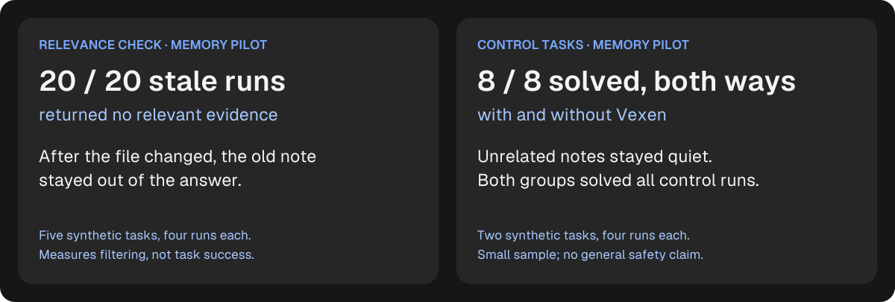
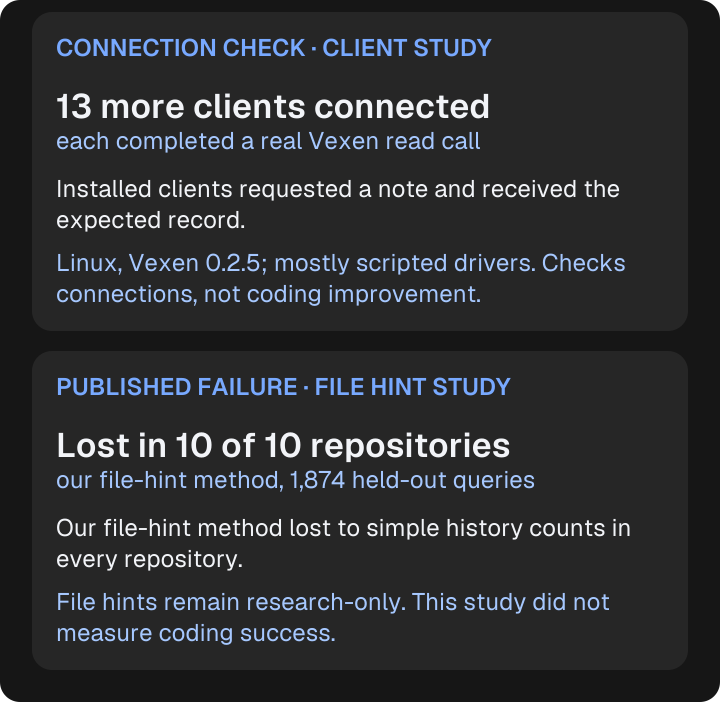

# Vexen research: claims you can check

Vexen carries saved failures and accepted decisions between coding sessions. Our studies ask separate questions: can a saved lesson help on a targeted task, does irrelevant evidence stay quiet, and can clients retrieve a record? A connection test is not a coding benchmark. These are internal experiments, not independent validation.

## Memory pilot

**Question:** Can pre-recorded knowledge of a hidden requirement help a coding agent complete a task?

**Result:** On five synthetic Python tasks, the Vexen-enabled condition passed 11 of 20 runs, versus 2 of 20 without memory. The absolute difference is 45 percentage points in this task set. We avoid “5.5× better” marketing because a ratio based on two baseline successes can suggest a broad effect the experiment does not establish.

**Conditions:** Claude Code with Haiku, a 14-turn limit, fresh task repositories and four repetitions per task and condition. Notes were prepared to match hidden requirements. The enabled condition included an explicit instruction to call `vexen_check`. The broader second pilot contains 76 runs, including stale-memory and unrelated-note controls; 76 is not the sample size of the 11/20 comparison.

**Retrieval qualification:** Recounting `pilot-2.jsonl`, all 20 enabled target runs called the tool. Their last logged statuses were `observed_failure` in 12 runs and `no_relevant_evidence` in eight. The 11/20 outcome is a condition-level result, not evidence that every run received an applicable note. The file stores the last status, not a full response history; it cannot establish why each run succeeded or failed. Older report wording attributing every failed run to an agent ignoring a received note is stronger than these rows support.

**Limits:** One model and agent, synthetic tasks, tailored notes, explicit prompting and only five task definitions. Repetitions share tasks; pooled Wilson intervals in the original report do not account for that clustering. No general coding uplift, autonomous memory-use rate, real-world repeat-error reduction or causal breakdown of retrieval versus application follows. Nine enabled runs failed. Seven initially lost parser results were rerun, as disclosed in the report.

**Sources:** [Report and intervals](pilot-results.md), [raw rows](../benchmarks/memory/results/pilot-2.jsonl), [method and reproduction command](../benchmarks/memory/README.md), [first three tasks](../benchmarks/memory/tasks.py), [additional tasks](../benchmarks/memory/tasks_extra.py).

### What did the coding tasks actually test?

These were small Python tasks with requirements hidden from the visible tests. The saved notes described earlier failures involving those requirements. Each row below includes all four repetitions per condition, rather than a selected successful run.

| Task | What the saved lesson explained | Without memory | Vexen enabled |
|---|---|---:|---:|
| Read an exported file | A special UTF-8 file marker needs to be handled | 1 / 4 | 3 / 4 |
| Calculate a price | `0.125` must round to `0.13` | 1 / 4 | 2 / 4 |
| Build a URL slug | `München` must become `muenchen` | 0 / 4 | 2 / 4 |
| Parse an export date | `04/03/2025` means 4 March | 0 / 4 | 2 / 4 |
| Read exported rows | Accept semicolons as well as commas | 0 / 4 | 2 / 4 |

These examples show the kind of project-specific lesson Vexen can carry. They are synthetic test cases, not customer stories. The notes were prepared in advance and the agent was told to check memory. In the Vexen-enabled group, all 20 runs called the tool; the last logged response contained a failure record in 12 and no relevant evidence in eight. Even with Vexen enabled, nine runs failed.

[Task definitions](../benchmarks/memory/tasks.py) · [Additional tasks](../benchmarks/memory/tasks_extra.py) · [Full results](pilot-results.md)

## Memory pilot, follow-up after the delivery fixes

**Why:** The first pilot left open whether the lesson reached the agent. A new run (`pilot-3`, same five quirk tasks, two controls, 76 cells, one seed, Claude Code 2.1.309 with Haiku on Windows) used the instrumented runner, which records every `vexen_check` call, its arguments and its status.

**What it showed:** Memory on: 12 of 20 passed, memory off: 3 of 20, stale note: 2 of 20, controls: 8 of 8 in both arms. The lesson was delivered (status `observed_failure`) in 14 of 20 memory-on runs; those 14 produced all 12 passes, and the 6 runs without delivery produced none. All 6 had a cause in common: the agent passed free text in the `query` argument, and Vexen treated that text as a filter, so a note for the very file asked about was hidden (0 of 6 delivered with `query`, 14 of 14 without).

**Fix:** with `paths` given, free text is now a hint and no longer hides the note for the asked file (`src/mcp/tools.rs`, regression test in `tests/lifecycle.rs`).

**After the fix (`pilot-4-memory-on`):** the 20 memory-on quirk cells were run again with the fixed binary: the lesson was delivered in 20 of 20 and 17 of 20 passed. This run has no memory-off arm of its own; compare with the 3 of 20 of `pilot-3`.

**Limits:** One model and agent, synthetic tasks, tailored notes, an explicit instruction to check memory, and four repetitions per cell on shared tasks (clustered, so the intervals are optimistic). The fix was made after looking at `pilot-3`'s failures, so `pilot-4` is a check of that fix, not an untouched test; the off and stale arms were not re-run. Only the memory-on rows were repeated; no cell was selected by outcome. This does not show general coding improvement. The published 11/20 versus 2/20 stays as it was.

**Sources:** [pilot-3 rows](../benchmarks/memory/results/pilot-3.jsonl), [table](../benchmarks/memory/results/pilot-3.table.md), [manifest](../benchmarks/memory/results/pilot-3.manifest.json), [pilot-4 rows](../benchmarks/memory/results/pilot-4-memory-on.jsonl), [table](../benchmarks/memory/results/pilot-4-memory-on.table.md).

## What a solved task cost

**Question:** Does remembering save money?

**Result:** A solved task cost 77.7% less with memory (the card rounds to 78%), but not because runs got shorter. In `pilot-3` (instrumented run, five quirk tasks, 20 runs per group, cost as reported by Claude Code) a run cost $0.0073 without memory and $0.0065 with relevant memory (10.9% less), while 3 of 20 (15%) and 12 of 20 (60%) runs passed. Dividing total cost by passing runs gives $0.0484 and $0.0108 per solved task, a 77.7% reduction. The first pilot (`pilot-2`) gives $0.070 and $0.011, and the post-fix memory-on run (`pilot-4-memory-on`) $0.0075. Memory-on runs took more turns (8.6 versus 5.3 on average), because they check memory first.

**Context cost:** a check returns at most 1,800 bytes of text (a tested cap), roughly 450 tokens at four bytes per token (an estimate, not a measurement).

**Limits:** Cost per solved task is a ratio of two small counts, so it moves a lot with one more or fewer success. One model, synthetic tasks, tailored notes, explicit prompting. In the memory-off runs the agent gave up on a wrong answer; this does not measure the cost of long retry loops that real work can have. It does not support a general claim that Vexen reduces tokens.

**Sources:** [pilot-2](../benchmarks/memory/results/pilot-2.jsonl), [pilot-3](../benchmarks/memory/results/pilot-3.jsonl), [pilot-4](../benchmarks/memory/results/pilot-4-memory-on.jsonl).

## Relevance checks

**Question:** What happens when the note is stale or about a different file?

**Result:** All 20 stale-memory target runs ended with `no_relevant_evidence`; none passed its hidden task test. On the two control tasks with notes about another file, all eight enabled runs returned no relevant evidence and passed. All eight memory-off control runs also passed.

**Practical meaning:** The recorded checks distinguish having memory available from having a relevant lesson to offer. Quiet behavior is part of the product's usefulness, but abstention alone does not solve the task.

**Limits:** These are slices of the same 76-run pilot, not independent replications. The stale group's 0/20 versus the memory-off group's 2/20 does not support a claim of no negative transfer across the entire pilot. The controls show no observed drop only on their two task definitions. They do not establish that Vexen is harmless in general.

**Sources:** [Raw rows](../benchmarks/memory/results/pilot-2.jsonl), [pilot design](../benchmarks/memory/README.md), [reported results](pilot-results.md).

## Client connections

**Question:** Can installed coding clients discover Vexen and complete a read call?

**Result:** Thirteen additional clients completed a real `vexen_check` call against Vexen 0.2.5 on Linux x86_64. This excludes the previously documented Claude Code, Codex CLI and OpenCode checks.

**Conditions:** One real-model run, eleven deterministic local-model drivers and one native editor API run. Actual clients launched the actual Vexen executable. Recorded fixture identity, tool calls and responses were audited with `python benchmarks/clients/verify_results.py`.

**Limits:** A one-session read check on a toy fixture does not measure task success, autonomous tool use, every Vexen tool, installer reliability or cross-platform support. Cursor, Kiro, Zed and Cline's editor-extension discovery-only observations are excluded from the thirteen. The successful Cline CLI run is counted.

**Sources:** [Client matrix and exact versions](client-smoke-tests.md), [manifest and tested source commit](../benchmarks/clients/results/2026-11-01/manifest.json), [evidence auditor](../benchmarks/clients/verify_results.py).

## Published failure: file suggestions from Git history

**Question:** Can a thresholded history-based method predict files that change together better than simple counts?

**Result:** Across 1,874 held-out queries in ten public repositories, thresholded Hit@3 was 0.3511, compared with 0.4274 for plain history counts. It lost on this metric in every repository. Although emitted precision was higher, it failed the default-feature gate. Co-change hints remain research-only.

**Practical meaning:** We publish a failed evaluation and keep the feature outside default hints. This is evidence of a product decision, not evidence that the memory feature improves coding.

**Limits:** One chronological split, a corpus weighted toward Rust CLI projects, fixed thresholds, no confidence intervals or human relevance labels. Predicting a file in a held-out commit does not show that changing the file was necessary or useful.

**Sources:** [Report, frozen revision and reproduction](benchmarks.md), [aggregate data](../benchmarks/cochange/results/results.json), [per-query data](../benchmarks/cochange/results/queries/).

## Standard for research cards and examples

Every research card follows the same order: **study type → measured result → plain-language meaning → test scope and limitation**. Nearby Markdown supplies a direct source link so the SVG never has to carry the full methodology.

- Give numerators and denominators together. Identify what was counted: runs, tool responses, clients or file queries.
- Name the comparison and preserve its scope. Say “enabled condition” when actual retrieval varied.
- Keep outcome, filtering, connection and product-decision evidence distinct. Do not combine them into a score or add their sample sizes.
- Treat slices of one pilot as related evidence, not separate confirmations.
- Use actual task requirements for examples. Show every task's counts together; label synthetic tasks and illustrative scenarios explicitly.
- Keep limitations readable and next to the result. Never turn 8/8 controls into a general safety promise, or thirteen client calls into thirteen models improving.
- Keep negative findings accessible. Avoid cost, speed and repeat-error claims until an appropriate evaluation supports them.

Cards use the existing Vexen palette and outlined Geist lettering. Regenerate them with `uv run --with fonttools python scripts/generate_readme_cards.py`. No model calls are made by that command.

## Reliability follow-up

The [ongoing reliability investigation](memory-reliability-investigation.md) records fixes and verification separately from task-outcome studies. It covers missing lesson text for text-only MCP clients, candidate cutoffs that hid older relevant records or contradictions, and improvements to experiment traces. Local regression and delivery checks are not a new success-rate benchmark. The published pilot remains 11/20 versus 2/20 until a fresh real-agent evaluation is completed and reported independently.
